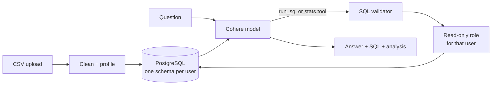

# AI Data Analyst

Upload a CSV, ask questions in plain English, and get answers backed by real SQL and real statistics. Every answer shows the exact query that produced it.

<p align="center">
  <!-- Record a short GIF (upload -> question -> follow-up -> statistics) and save it as docs/demo.gif -->
  
</p>

## What it does

- **Upload data.** CSV/TSV files are cleaned (whitespace, `?`/`NA`/`null` markers become real NULLs, numeric columns are detected, column names are made SQL-safe), profiled, and loaded into PostgreSQL.
- **Ask in plain English.** A Cohere model writes SQL, runs it, reads any error, and fixes its own mistakes.
- **Run real statistics.** The model can call five tested tools:

  | Tool | What it does |
    |---|---|
  | `run_regression` | Linear regression with robust standard errors, VIF, heteroscedasticity test |
  | `run_logistic_regression` | Odds ratios, McFadden R², AUC, accuracy vs. baseline |
  | `run_correlations` | Pearson/Spearman with Bonferroni and Benjamini-Hochberg corrections |
  | `run_categorical_test` | Chi-square tests with Cramér's V effect sizes |
  | `compare_groups` | Welch t-test + Mann-Whitney (2 groups), ANOVA + Kruskal-Wallis (3+), with effect sizes |

- **Remember the conversation.** Follow-ups like "now split that by sex" or "redo it with separate class columns" work.
- **Browser UI.** Dataset picker, upload, formatted answers, highlighted SQL, data tables, bar charts, statistics cards, dark mode, mobile layout.

## How it works



The model never executes code. It can only call the fixed tools above, and every query goes through the safety layers below.

## Safety design

AI-generated SQL is treated as untrusted. Layers, from outermost to innermost:

1. **SQL validator** (`sqlglot`): exactly one `SELECT`; no writes or DDL; no schema-qualified names; only the user's own tables; no table-valued functions; dangerous functions (`pg_*`, `set_config`, `dblink`, ...) blocked.
2. **Per-user database role.** Each user gets a schema (`user_<id>`) and a `NOLOGIN` role that can only `SELECT` from it. Queries run after `SET LOCAL ROLE`, so Postgres itself blocks cross-user access even if the validator were bypassed.
3. **Read-only transaction, statement timeout (10 s; 30 s for statistics), and a server-side cursor** capped at 1,000 rows (200,000 for statistics) so a huge result never loads into memory.
4. **Separate database logins.** The query login has no privileges of its own and is read-only by default; ingestion uses a different login.
5. **Prompt-injection guidance.** Text inside uploaded data is treated as data, never as instructions.

`python -m app.isolation_check` demonstrates layer 2 by bypassing the validator on purpose.

## Quick start

**Requirements:** Python 3.10+, PostgreSQL 15+, a [Cohere](https://dashboard.cohere.com/api-keys) API key.

```bash
git clone <your-repo-url>
cd Ai-Data-Analyst
python -m venv .venv
.venv\Scripts\activate          # macOS/Linux: source .venv/bin/activate
pip install -r requirements.txt
```

**1. Create the database and roles.** Edit the two passwords in `app/database/setup.sql`, then run it as a Postgres superuser. It has two steps: step 1 on your default database, step 2 after reconnecting to `ai_data_analyst` (in `psql`: `\c ai_data_analyst`).

**2. Configure.** Copy `.env.example` to `.env` and fill it in:

| Variable | Purpose |
|---|---|
| `INGEST_DATABASE_URL` | Login that creates schemas/tables and loads data |
| `QUERY_DATABASE_URL` | Login used for AI-generated queries (read-only) |
| `QUERY_DB_ROLE` | Name of the query login (default `app_query`) |
| `COHERE_API_KEY` | Your Cohere key |
| `COHERE_MODEL` | Optional; default `command-a-03-2025` |

Special characters in database passwords must be percent-encoded in the URLs (for example `$` becomes `%24`). `.env` is git-ignored; never commit it.

**3. Load the sample data.** Download the [Adult dataset](https://archive.ics.uci.edu/dataset/2/adult), put `adult.data` in `datasets/`, then:

```bash
python -m app.db_demo
```

This loads it for user `demo` and runs a few good and deliberately bad queries to show the safety layers working.

**4. Start the app.**

```bash
uvicorn app.api.server:app --reload
```

Open <http://127.0.0.1:8000/>. Interactive API docs are at `/docs`. For a terminal chat instead: `python -m app.ai.assistant`.

## Try these questions

| Dataset | Question |
|---|---|
| Titanic | What percentage of passengers survived in each class, split by sex? |
| Titanic | What predicts survival? Use age, fare, passenger class and being female. |
| Adult | Do men work more hours per week than women? |
| Adult | Which categorical columns are most associated with income? |
| Adult | What is the average income in dollars? *(the data only has brackets; it should say so)* |

## API

All endpoints need an `X-User-Id` header (lowercase letters, digits, underscores).

| Endpoint | Description |
|---|---|
| `GET /` | The web UI |
| `GET /health` | Health check |
| `POST /datasets` | Upload a file (`file`, optional `table_name`, `has_header`, `replace`). Max 50 MB. |
| `GET /datasets` | List your tables. `?include_profile=true` adds full column statistics. |
| `POST /ask` | `{"question": "...", "table": "optional", "history": [...]}` returns the answer, SQL, analyses, and a `turn` object to send back as history for follow-ups. |

## Project structure

```
Ai-Data-Analyst/
├── app/
│   ├── ai/                    # assistant loop, memory, statistics tools
│   ├── api/                   # FastAPI server, upload parsing
│   ├── data/                  # loader, cleaner, profiler
│   ├── database/              # connections, ingestion, safe querying, per-user tenancy, setup.sql
│   ├── statistical_analysis/  # regression, logistic regression, correlation, categorical, group comparison
│   ├── static/index.html      # web UI (single file, no build step)
│   ├── db_demo.py             # end-to-end smoke test
│   └── isolation_check.py     # proves the database role blocks writes and cross-user reads
├── evals/                     # accuracy checks for the AI (see below)
├── tests/                     # pytest suite
├── datasets/                  # put sample data here
└── docs/                      # demo.gif
```

## Tests and evals

```bash
pytest                          # unit tests; no API calls or AI needed for most
python -m evals.run_evals       # runs real questions with known answers against the AI
python -m evals.run_evals --only titanic_logistic
```

The evals use Adult and Titanic questions whose correct answers are known, and check the **executed results**, not just the wording. They also warn when an answer states a number that appears nowhere in the results. A full run uses roughly 25-35 Cohere calls. Load Titanic for user `demo` as table `titanic` before running them; cases whose table is missing are skipped.

### What the evals caught

- **Integer division.** Percentages came back truncated (96 instead of 96.8). Fixed with a prompt rule and a tolerance in the eval that distinguishes rounding from truncation.
- **Invented numbers.** For an ordinal predictor (passenger class 1/2/3) the model reported per-class odds ratios that the tool never produced. Fixed in the prompt, and the grounding check now flags this pattern.
- **Silent table guessing.** With two datasets loaded, an ambiguous question was answered from the wrong table. Fixed with table scoping in the UI and API.

## Known limitations

- **No real authentication.** `X-User-Id` is a development placeholder: anyone who can reach the server can act as any user. Keep it on `127.0.0.1` until real auth is added.
- **Cohere trial keys** are rate limited (about 20 requests/minute, 1,000 calls/month) and meant for non-commercial use; check Cohere's current terms.
- Dates are loaded as plain text, not parsed.
- `NA`, `null`, `?` and similar strings are always treated as missing; there is no per-upload option yet.
- Logistic regression accuracy/AUC are measured on the training data (flagged as optimistic in every result).
- A new database connection is opened per request (no pooling).

## Roadmap

Real authentication and per-user question limits · deleting datasets · date parsing · configurable missing-value markers · held-out validation for logistic regression · connection pooling · machine learning methods · hypothesis testing

